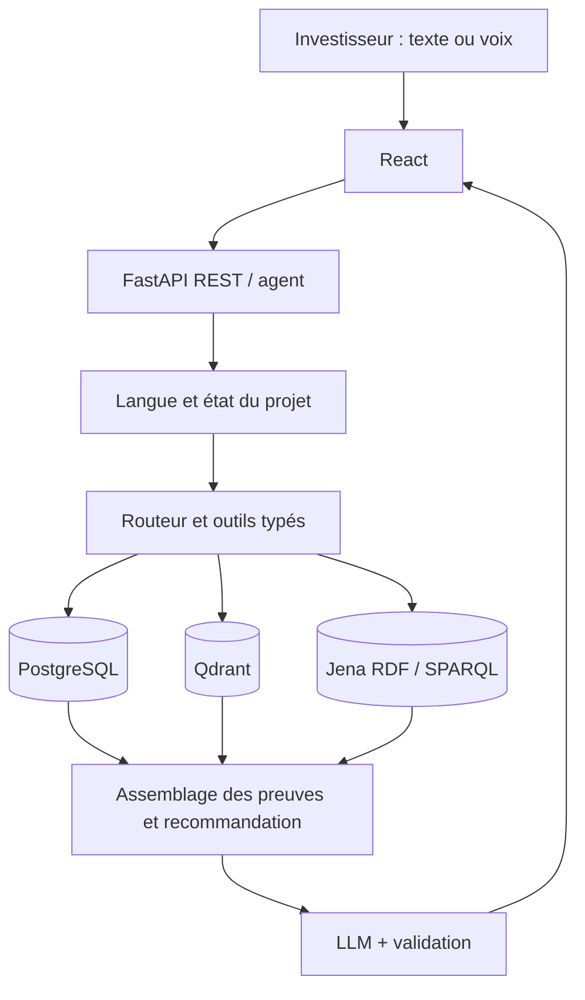
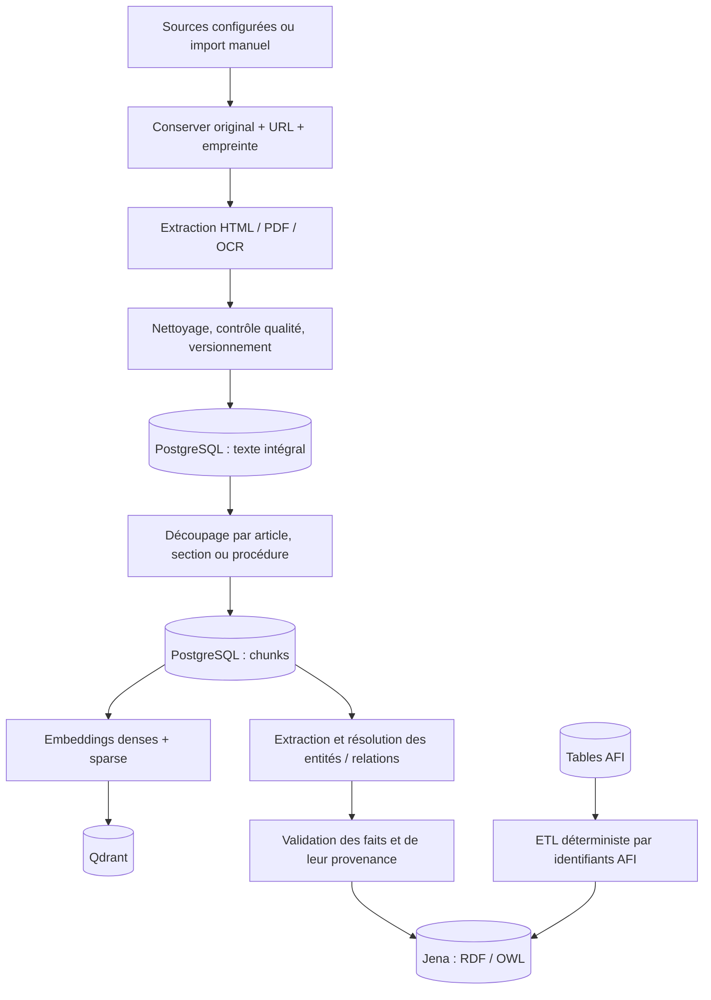

# Dalila — Pipeline de données et architecture technique

**Document de référence pour l’équipe du hackathon AFI**  
Version : 26 novembre 2026

## 1. Besoin et périmètre

Développer un assistant interactif accompagnant l’investisseur dans son parcours auprès de l’AFI :

- Rechercher, comparer et recommander des zones et des lots industriels selon l’activité, le budget, la superficie, les infrastructures et la proximité.
- Orienter vers les services AFI : acquisition, enchères, situation foncière, insertion d’hypothèque, mainlevée, acte de précision/contrat final, autorisation de vente liée au leasing, copie conforme.
- Expliquer les démarches, pièces, tarifs, conditions et organismes compétents, avec références officielles.
- Répondre aux questions juridiques, aux questions sur les cahiers des charges des zones et aux questions relatives aux incitations à l’investissement.
- Poser des questions complémentaires, conserver le contexte du projet et fournir des liens, boutons, cartes et comparaisons.
- Prendre en charge le texte et la voix dans les huit langues prévues : tunisien (dont Arabizi), français, anglais, arabe standard, algérien, libyen, allemand et turc.
- Prévoir un apprentissage contrôlé et une administration des sources et connaissances.

**Contexte réel :** le backend Dalila d’origine n’a pas été fourni. L’équipe dispose d’un dump AFI migré vers PostgreSQL et d’un backend FastAPI REST fonctionnel en lecture seule. La collecte documentaire est déjà en cours. Le nouveau backend reproduit les capacités nécessaires sans prétendre réutiliser un code indisponible.

## 2. Architecture retenue

| Composant | Technologie | Responsabilité |
|---|---|---|
| Frontend | React + TypeScript | Chat, voix, cartes, boutons, comparaison, administration |
| API | FastAPI REST, Pydantic | Validation, endpoints, orchestration |
| Accès SQL | SQLAlchemy 2.x + Psycopg 3 | Lecture des données AFI |
| Base relationnelle | PostgreSQL | Données structurées, corpus extrait, versions, sessions et audit |
| Recherche géographique | PostGIS facultatif | Distances et proximité ; calcul Python possible au départ |
| Extraction | BeautifulSoup/Trafilatura, PyMuPDF/Docling, OCR si nécessaire | HTML, PDF, tableaux, pages et articles |
| Embeddings | BGE-M3 (à évaluer) | Vecteurs multilingues et recherche sémantique |
| Index documentaire | Qdrant | Recherche dense + sparse/lexicale, métadonnées et références |
| Reranking | Cross-encoder multilingue | Réordonner les passages candidats |
| Graphe | RDFLib + Apache Jena Fuseki | Ontologie OWL 2, RDF, SPARQL 1.1, export Turtle |
| Validation du graphe | SHACL + raisonneur OWL adapté au profil | Validation des formes et cohérence logique |
| GraphRAG | Pipeline Python graph-enhanced RAG | Relier entités, chemins du graphe et extraits documentaires |
| Agent | Workflow Python typé ; LangGraph si utile | Intentions, outils, état de conversation et actions chaînées |
| Modèle de langage | Une API LLM sélectionnée et testée | Compréhension, reformulation et réponse fondée sur les preuves |
| Voix | Adaptateurs STT/TTS | Transcription et synthèse, test des dialectes |
| Tests | pytest + corpus de référence | Exactitude, citations, langues, latence, non-régression |

REST est conservé : GraphQL n’est pas nécessaire. SPARQL reste interne au module sémantique. Neo4j n’est pas nécessaire puisque Jena héberge le graphe RDF. Redis est facultatif après mesure des performances.



## 3. Collecte : quelles sources et comment ?

| Organisme | Contenu à collecter selon disponibilité |
|---|---|
| AFI | Services, procédures, zones, formulaires, cahiers des charges, cadre juridique |
| TIA | Incitations, conditions d’investissement et guides |
| SICAD | Démarches administratives et pièces justificatives |
| FIPA | Informations et guides pour investisseurs |
| APII | Secteurs industriels, création de projets, accompagnement |
| APIA | Investissements agricoles et activités associées |
| INS | Statistiques économiques et régionales |
| Ministères / JORT | Lois, décrets, règlements et modifications applicables |

**Règle de collecte :** la mention « sans lecture automatique » discutée dans le cahier implique de ne pas présumer qu’une collecte automatique est autorisée pour les organismes concernés. Pour ces sources, utiliser des références et documents sélectionnés/importés manuellement. Pour les URL dont la lecture automatique est autorisée et configurée, prévoir un lecteur avec actualisation et gestion des erreurs. Respecter les permissions et conditions d’accès ; ne pas transformer la liste en crawler sans restriction.

## 4. Où stocker les données réelles ?

| Donnée | Emplacement principal | Copie / index dérivé |
|---|---|---|
| Zones, lots, prix, infrastructures AFI | PostgreSQL, tables AFI existantes | Graphe : identifiants et relations stables uniquement |
| PDF et HTML originaux collectés | `data/raw/` ou stockage objet | Référence et empreinte dans PostgreSQL |
| Texte intégral extrait de TIA, SICAD, FIPA, APII, APIA, AFI, INS, ministères | PostgreSQL, `document_versions.full_text` | Fichier texte facultatif pour inspection |
| Paragraphes et articles découpés | PostgreSQL, `document_chunks.text` | Qdrant : vecteurs + payload + identifiant du chunk |
| Entités et relations validées | Jena, RDF/OWL | Provenance vers documents/chunks PostgreSQL |
| Sessions, feedback, apprentissage, audit | PostgreSQL, schéma applicatif distinct | Aucun transfert de données personnelles non autorisé |

PostgreSQL est le référentiel opérationnel de l’application. Les publications originales et les autorités compétentes restent les références officielles pour le droit et les procédures. Le dump AFI est un instantané : ne pas présenter son prix ou statut comme actuel sans preuve de fraîcheur.

## 5. Pipeline d’ingestion (hors conversation)



1. Enregistrer la source, son organisme, son URL, le mode de collecte autorisé et sa date de récupération.
2. Conserver le fichier original et son hash SHA-256.
3. Extraire le texte avec les titres, tableaux, numéros d’articles et pages ; vérifier la qualité de l’OCR.
4. Stocker le texte complet dans PostgreSQL, avec la version de document.
5. Découper par unité de sens : article juridique, clause de cahier des charges, étape de procédure. Tester 400–800 tokens et 50–100 tokens de recouvrement lorsque nécessaire.
6. Enregistrer les chunks dans PostgreSQL avec leurs identifiants stables et leur provenance.
7. Générer les embeddings BGE-M3 par lots et indexer Qdrant (dense + sparse ou BM25 compatible).
8. Extraire les entités et relations candidates des chunks ; résoudre les doublons et synonymes ; vérifier les faits avant publication RDF.
9. Générer séparément les relations stables issues des tables AFI via un ETL déterministe.
10. Publier les index et le graphe avec la même référence de version ; conserver les erreurs et permettre une reprise idempotente.

Ne pas vectoriser toute la base de lots pour effectuer des filtres numériques. Ne pas transformer automatiquement chaque phrase en triple RDF.

## 6. Schéma PostgreSQL proposé

Conserver les tables AFI existantes en lecture seule. Ajouter un schéma `assistant` via une migration séparée, examinée et autorisée ; le backend actuel ne crée ni ne modifie de tables. Utiliser des rôles distincts pour la lecture AFI et l’écriture applicative.

| Table proposée | Colonnes essentielles |
|---|---|
| `assistant.sources` | id, organisation, url, title, ingestion_mode, enabled, last_status, last_error, last_checked_at |
| `assistant.documents` | id, source_id, title, type, zone_id (nullable), language |
| `assistant.document_versions` | id, document_id, sha256, original_path, full_text, retrieved_at, publication_date, effective_date, validity_status |
| `assistant.document_chunks` | id (UUID), version_id, text, page_from, page_to, article, section, ordinal |
| `assistant.ingestion_runs` | id, source_id, version_id, status, error, timestamps |
| `assistant.conversations`, `messages`, `projects` | identifiants, contexte, langue, état et historique minimal |
| `assistant.feedback`, `learning_candidates`, `audit_logs` | propositions, preuves, décisions, versions, rollback |

Relier les nouvelles tables par clés primaires/étrangères et contraintes d’unicité. Indexer les clés et champs utilisés dans les filtres. Les anciens champs codés et les données AFI ne sont pas modifiés implicitement.

### État constaté dans le rapport d’inspection fourni

- 185 zones, 6 579 lots, 1 628 services de proximité, 1 501 commodités, 106 documents de zone, 85 connaissances et 150 sources chatbot.
- `zones.code_zone` est un entier ; `lots.zone_id` est un texte. Jointure vérifiée : `zones.code_zone::text = lots.zone_id`.
- 24 lots sans zone correspondante : les conserver et les signaler, sans inventer de correspondance.
- Aucune PK/FK/contrainte unique/index déclaré sur les tables inspectées ; vérifier et proposer une migration dédiée si nécessaire.
- `lot_etat`, `lot_valid`, `lot_etat_init`, unités de surface/prix et capacité des commodités doivent être interprétés à partir de définitions fiables.
- Ne pas exposer les champs promoteur, contrat, dossier ou les logs bruts.

## 7. Liaison concrète PostgreSQL ↔ Qdrant ↔ Jena

Les trois systèmes ne se connectent pas automatiquement entre eux. **FastAPI/Python assure la liaison via des identifiants communs.**

Exemple fictif : document `DOC-015`, version `VER-001`, chunk UUID `550e8400-e29b-41d4-a716-446655440000`.

**PostgreSQL** : le document, sa version et le texte exact du chunk sont conservés.

**Qdrant** : le point utilise l’UUID du chunk (Qdrant accepte les UUID ou entiers non signés comme identifiants de points).

```json
{
  "id": "550e8400-e29b-41d4-a716-446655440000",
  "vector": [0.12, 0.34, 0.56],
  "payload": {
    "document_id": "DOC-015",
    "version_id": "VER-001",
    "chunk_id": "550e8400-e29b-41d4-a716-446655440000",
    "source_id": "SRC-002",
    "language": "fr",
    "document_type": "administrative_procedure",
    "zone_id": null,
    "page": 4
  }
}
```

Vecteur abrégé uniquement pour illustrer ; en pratique utiliser les dimensions réelles du modèle et des vecteurs nommés pour la recherche hybride. Le texte peut aussi être dans le payload pour éviter une requête supplémentaire, mais la version de référence reste dans PostgreSQL.

**Jena** : les entités RDF utilisent des URI stables et pointent vers les mêmes identifiants.

```turtle
@prefix afi: <https://example.org/afi/ontology#> .
@prefix id: <https://example.org/afi/resource/> .
@prefix prov: <http://www.w3.org/ns/prov#> .

id:procedure001 a afi:Procedure ;
    afi:documentedBy id:DOC-015 .
id:DOC-015 afi:documentId "DOC-015" ;
    afi:hasVersion id:VER-001 .
id:VER-001 afi:hasChunk id:chunk-550e8400-e29b-41d4-a716-446655440000 .
id:chunk-550e8400-e29b-41d4-a716-446655440000
    afi:chunkId "550e8400-e29b-41d4-a716-446655440000" ;
    prov:wasDerivedFrom id:VER-001 .
```

URI de démonstration : choisir un namespace stable avant production. Pour chaque relation métier extraite, enregistrer aussi le chunk justificatif, la version et le statut de validation (par exemple dans un graphe nommé avec provenance). Ne pas exposer SPARQL arbitraire au LLM.

## 8. Ontologie et GraphRAG

Les neuf familles retenues : lieu, lot, secteur d’activité, commodité/proximité, démarche, incitation, organisme, projet, service AFI. Ajouter Document, Article, Extrait, Exigence et Autorisation pour relier les preuves.

Exemples de relations : `IndustrialZone locatedIn Governorate`, `IndustrialLot belongsTo IndustrialZone`, `Zone hasSpecification Document`, `Service requiresDocument DocumentType`, `Procedure hasStep Step`, `Activity subjectTo Requirement`, `Organization providesService Service`.

- Définir les classes et propriétés dans `ontology/afi_ontology.ttl`.
- Alimenter les instances dans Jena depuis PostgreSQL et les relations documentaires validées.
- Associer les labels et synonymes multilingues avec `rdfs:label` / `skos:altLabel` et tags de langue adaptés (ex. `ar-TN`, `ar-DZ`, `ar-LY`, `ar-Latn-TN` pour Arabizi).
- Les prix et disponibilités restent en SQL ; le graphe conserve les identifiants AFI et les relations stables.
- L’absence de relation ne prouve pas une interdiction ou une indisponibilité.
- Valider les formes avec SHACL et la cohérence avec un raisonneur OWL adapté ; exporter en Turtle, tester SPARQL 1.1.

GraphRAG = recherche vectorielle/lexicale + expansion ciblée du graphe + récupération des preuves. Ce n’est pas simplement trois bases interrogées en parallèle.

## 9. Pipeline d’une question (en ligne)

Exemple : « N7eb na3mel usine textile fi Ariana, 5000 m², budget 600 mille. »

1. Détecter la langue, normaliser Arabizi et mélange de langues, conserver le contexte.
2. Extraire activité, région, superficie, budget, contraintes ; demander uniquement les informations essentielles manquantes.
3. Résoudre les concepts et identifiants via le module sémantique.
4. Router : SQL pour les faits chiffrés, RAG pour les documents, graphe pour les relations ; combiner selon le besoin.
5. Rechercher les lots candidats dans PostgreSQL ; ne pas supposer leur disponibilité.
6. Interroger Jena par SPARQL pour obtenir les relations et les documents liés aux zones candidates et à l’activité.
7. Rechercher dans Qdrant en filtrant par zone, version et type documentaire lorsque pertinent ; combiner recherche dense et lexicale ; récupérer aussi les textes liés par le graphe.
8. Reranker, dédupliquer et sélectionner les preuves ; vérifier la version et la provenance dans PostgreSQL.
9. Appliquer les contraintes vérifiées puis classer les candidats selon les préférences. Distinguer compatibles confirmés, candidats à vérifier et incompatibles.
10. Le LLM produit une réponse sourcée dans la langue du visiteur ; le backend valide les chiffres et citations, retourne cartes, boutons, démarches et alternatives.
11. Conserver le contexte ; permettre une question juridique ou administrative de suivi. Générer la voix séparément sans bloquer le texte.

Pour une question simple sur un prix ou une superficie, une requête SQL suffit. Pour une question de procédure, Hybrid RAG peut suffire. GraphRAG est utilisé lorsque plusieurs relations ou documents sont nécessaires.

## 10. Modules fonctionnels

| Module | Responsabilité |
|---|---|
| Communication | REST, streaming SSE si utile, chat, liens, boutons, cartes, feedback |
| Langue | Détection, normalisation dialectale, extraction, rédaction multilingue |
| Voix | STT, transcription visible, correction, TTS, contrôles et repli texte |
| Sémantique | Ontologie, résolution d’entités, SPARQL, Hybrid RAG et GraphRAG |
| Traitement | Recherche terrain, proximité, qualification, étude de projet, recommandation et comparaison |
| Sources | Gestion des URL autorisées, import manuel, extraction, versionnement, relance, erreurs, indexation |
| Apprentissage | Signaux anonymisés, propositions sourcées, tests, publication contrôlée et rollback |
| Administration | Sources, connaissances, moteurs, droits, supervision et audit |

## 11. Actualisation et apprentissage

- Lors d’une mise à jour autorisée, comparer le hash ; ne réindexer que les versions modifiées.
- Préparer les nouveaux chunks et triples en staging, vérifier puis activer la version cohérente ; ne pas servir un mélange d’anciennes et nouvelles versions. Prévoir reprise sur erreur et réconciliation des index.
- Conserver les versions précédentes pour audit et rollback ; exclure les versions obsolètes de la recherche courante.
- Repérer les questions incomprises et feedback négatifs ; anonymiser avant traitement.
- Proposer des synonymes/concepts à partir de plusieurs conversations distinctes ; exiger une preuve officielle pour tout ajout factuel.
- Tester la cohérence du graphe et la non-régression avant publication automatique contrôlée ; enregistrer les décisions et permettre à l’administration d’annuler un ajout.
- Ne jamais apprendre un prix, une disponibilité ou une règle juridique à partir d’une affirmation de visiteur.

## 12. Performance et sécurité

- Pré-calculer embeddings et relations hors conversation ; ne pas scraper à chaque question.
- Limiter les appels LLM, paralléliser les recherches indépendantes, borner le graphe à 1–2 sauts au départ.
- Filtrer avant récupération ; tester 10–20 candidats puis 3–6 extraits rerankés ; adapter aux résultats de l’évaluation.
- Ajouter les index SQL après revue, pool de connexions, cache des données stables avec invalidation par version.
- Mesurer p50/p95, latence STT, SQL, Qdrant, SPARQL, reranking et LLM. Objectifs retenus de nos échanges sur le cahier : réponse écrite ≤ 35 s, STT ≤ 4 s après fin de parole, exactitude prix/disponibilité 100 % sur le jeu de test, résultats cohérents dans les huit langues.
- Séparer rôles lecture/écriture et administration ; garder secrets hors Git ; ne pas envoyer de données personnelles aux API externes.
- Restreindre les URL et accès réseau de l’ingestion (SSRF, redirections, taille maximale, timeout), considérer les documents comme données non fiables et ignorer leurs instructions adressées à l’agent.
- Ne pas prétendre soumettre une demande, certifier un statut juridique ou réserver un lot sans intégration officielle et confirmation appropriée.

## 13. Plan d’implémentation immédiat

| Ordre | Travail | Critère de réussite |
|---|---|---|
| 0 — acquis | PostgreSQL migré + FastAPI REST lecture seule | Endpoints zones/lots fonctionnels |
| 1 | Définir le contrat d’import avec le collègue chargé de la collecte ; créer le schéma `assistant` après validation | Un document et son texte complet stockés et traçables |
| 2 | Construire extraction, chunking, embeddings et Qdrant | Question administrative → extrait exact avec URL/page |
| 3 (en parallèle) | Construire ontologie, ETL SQL→RDF, Jena et SPARQL | Zone/lot/activité résolus, graphe cohérent |
| 4 (en parallèle) | Recommandation SQL/Python et audit métier | Filtres et classement sans fausse disponibilité |
| 5 | GraphRAG : entités, expansion, chunks liés, hybrid search, reranking | Question multi-document → chemins et citations |
| 6 | Agent, modules langue et services, contexte projet, frontend | Parcours investisseur interactif de bout en bout |
| 7 | Voix, apprentissage contrôlé, administration, benchmarks | Démo, tests multilingues, rollback et rapport de limites |

**Premier test vertical :** importer un document SICAD et un cahier AFI, les stocker dans PostgreSQL, les indexer dans Qdrant, créer des relations sourcées dans Jena, puis poser une question nécessitant la navigation entre ces systèmes. Étendre ensuite à l’ensemble du corpus.

### Contrat de livraison des documents collectés

```json
{
  "source_name": "AFI",
  "source_url": "URL officielle exacte",
  "ingestion_mode": "manual",
  "title": "Titre original",
  "document_type": "zone_specification",
  "language": "fr",
  "zone_id": null,
  "publication_date": null,
  "effective_date": null,
  "retrieved_at": "2026-11-26",
  "file_path": "data/raw/afi/document.pdf",
  "verification_status": "pending"
}
```

Les champs inconnus restent `null`. Ne pas inventer une date, une zone, un droit ou un statut. Conserver le fichier original.

## 14. Organisation indicative du dépôt

```text
afi-chatbot/
  backend/app/
    api/
    communication/
    language/
    voice/
    semantic/      # RDF, SPARQL, RAG, GraphRAG
    processing/    # recherche et recommandation
    sources/       # ingestion, versionnement, indexation
    learning/
    administration/
    repositories/
  data/raw/        # originaux, hors Git si nécessaire
  data/processed/  # sorties de contrôle facultatives
  ontology/        # TTL, SHACL, requêtes SPARQL
  frontend/
  tests/
  .env.example
  README.md
```

## 15. Limites et décisions

Ce document consolide les décisions de nos échanges, le rapport d’inspection PostgreSQL communiqué et les contraintes du cahier déjà discutées ; il ne constitue pas une nouvelle vérification exhaustive du PDF original ni des sites. Les modèles, seuils de retrieval, schéma applicatif et stratégie de versionnement sont des choix techniques proposés à valider par l’équipe. La signification des statuts AFI, la fraîcheur des prix, les droits de collecte, les règles juridiques et la qualité vocale par dialecte restent à confirmer. Aucun résultat de performance n’est présenté comme déjà atteint.
